# React Native learning apps

Small Expo apps built step by step to learn React Native. Each project gets a showcase block below: screenshots, a YouTube demo, and the libraries worth studying.

---

## `01_rn_basics` — Pokédex-style client

A hobby training app that talks to [PokeAPI](https://pokeapi.co) and grows through four native tabs. The list paginates and drills into detail; favorite and map pins persist in SQLite on device. The camera tab uses face detection to stick your favorite Pokémon on screen and save a composed photo.

 

  

    
  

  

    <strong><a href="https://www.youtube.com/shorts/C_FTkzZ7Y3o">▶ youtube.com/shorts/C_FTkzZ7Y3o</a></strong>
  

 

  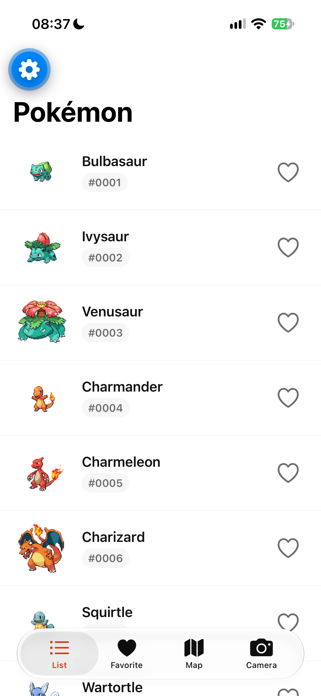
  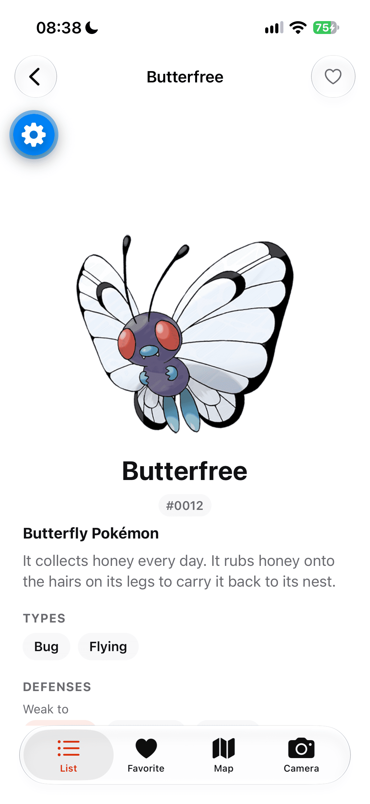
  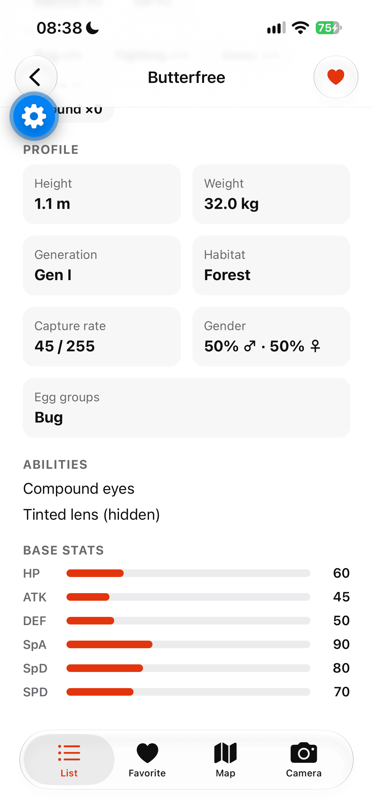

  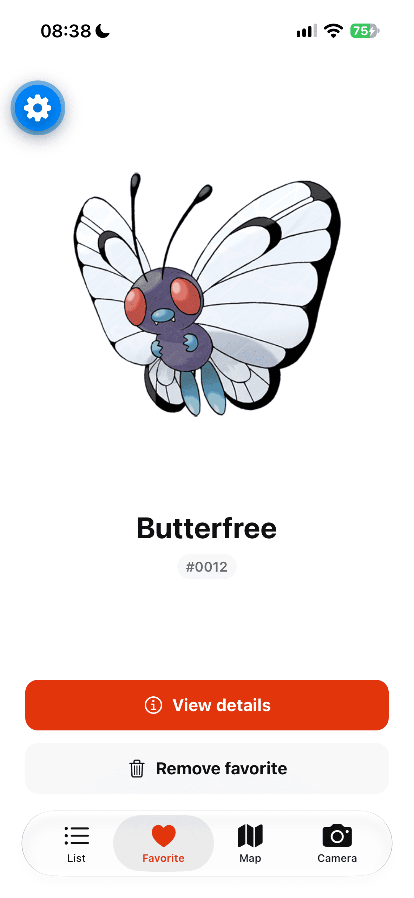
  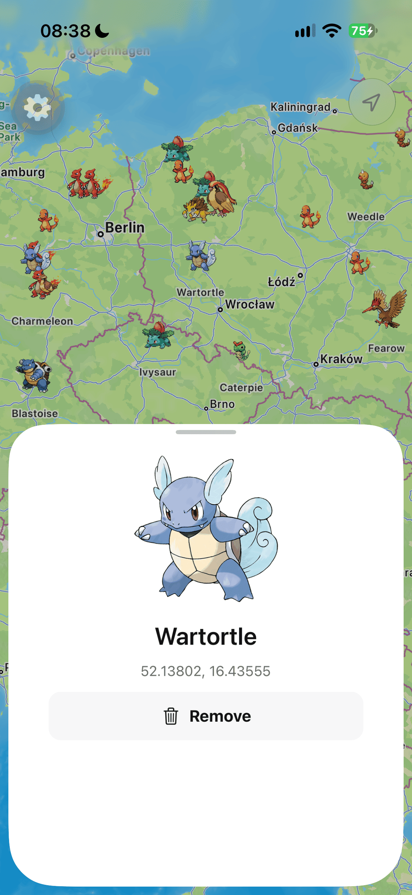
  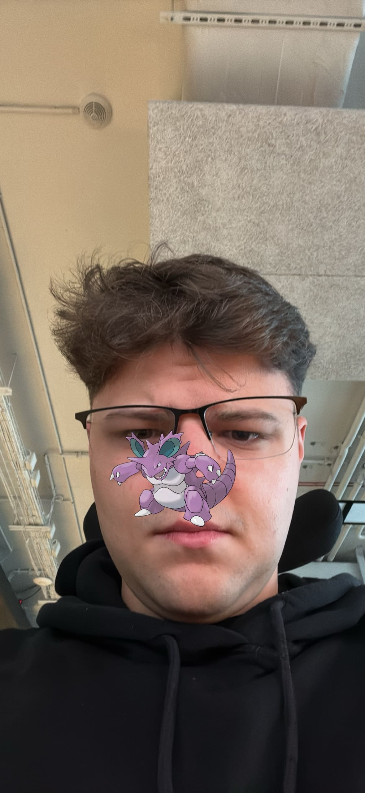

**Stack highlights**

- [Expo Router](https://docs.expo.dev/router/introduction/) — file routes, [native tabs](https://docs.expo.dev/router/advanced/native-tabs/), nested stacks for list → detail
- [expo-sqlite](https://docs.expo.dev/versions/latest/sdk/sqlite/) + [Drizzle ORM](https://orm.drizzle.team/) — favorites and map pins with migrations
- [expo-maps](https://docs.expo.dev/versions/latest/sdk/maps/) — fullscreen map, annotations, bottom sheets for pin UX
- [react-native-vision-camera](https://react-native-vision-camera.com/) — camera preview, face-guided sticker placement (iOS)
- [react-native-view-shot](https://github.com/gre/react-native-view-shot) + [expo-media-library](https://docs.expo.dev/versions/latest/sdk/media-library/) — capture composed shots to the gallery
- [react-native-reanimated](https://docs.swmansion.com/react-native-reanimated/) — animations and worklets (React Compiler–friendly patterns)
- [expo-image](https://docs.expo.dev/versions/latest/sdk/image/) + [react-native-nitro-image](https://github.com/mrousavy/nitro/tree/main/packages/react-native-nitro-image) — fast Pokémon artwork loading
- [ESLint](https://eslint.org/) + [Prettier](https://prettier.io/) + [Bun](https://bun.sh/) — lint and format JS/TS; [SwiftFormat](https://github.com/nicklockwood/SwiftFormat) / [ktlint](https://pinterest.github.io/ktlint/) for native modules under `apps/**/modules/`

---

## `02_rn_perf` — feed performance workshop

A mock social feed (home, post detail, threaded comments) used to practice **JavaScript-side** React Native performance. Each exercise starts from a profiler-visible bottleneck—parent re-renders, blocking first paint, or heavy list rows—and lands a fix you can re-measure on the same workflow in React Native DevTools (Profiler and Performance tabs). Hermes, React 19, Expo SDK 58; frame budget is **16 ms** at 60 fps.

 

  

    
  

  

    <strong><a href="docs/readme-assets/02-rn-perf/pokemon-4_0-performance-js-summary.md">▶ JS performance summary (exercises 1–4)</a></strong>
  

 

| Exercise | What changed                                                            | Before → after                                                          |
| -------- | ----------------------------------------------------------------------- | ----------------------------------------------------------------------- |
| 1        | Like/bookmark in `PostDetailEngagement`                                 | Whole `./post/[id]` ~74 ms → **2.2 ms** on the control (~33×)           |
| 2        | Split `PostDetailScreen`, isolated `CommentInput`, theme in root layout | `VirtualizedList` commit **262 ms → 17 ms** (~15×)                      |
| 2.3      | React Compiler on the feed                                              | Heaviest like commit **~204 ms → ~52 ms** (~4×)                         |
| 3        | `Activity` + `startTransition` for related posts                        | Footer off the first interactive paint                                  |
| 3.2      | Deferred mock feed hydration + compiler                                 | First Home commit **~197 ms → ~56 ms** (~3.5×)                          |
| 4        | `FeedImage` (`expo-image`), `IconSymbol`, tighter `FlatList` window     | Less decode/layout work per row (−528 / +91 lines in the measured diff) |

  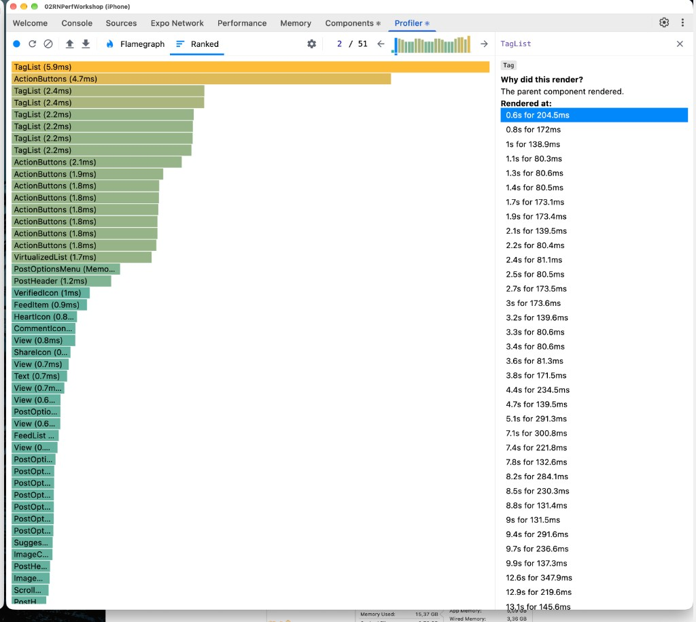
  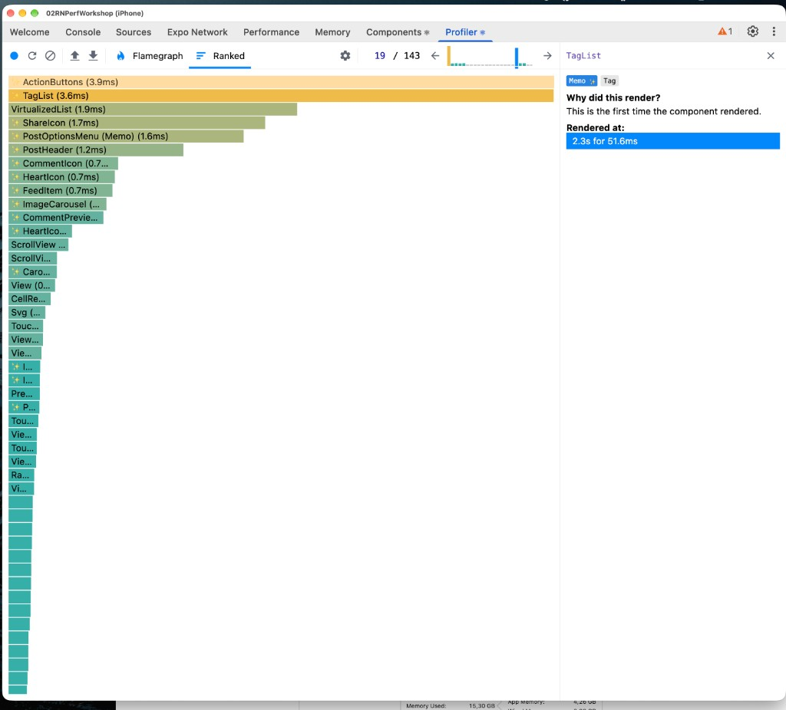

  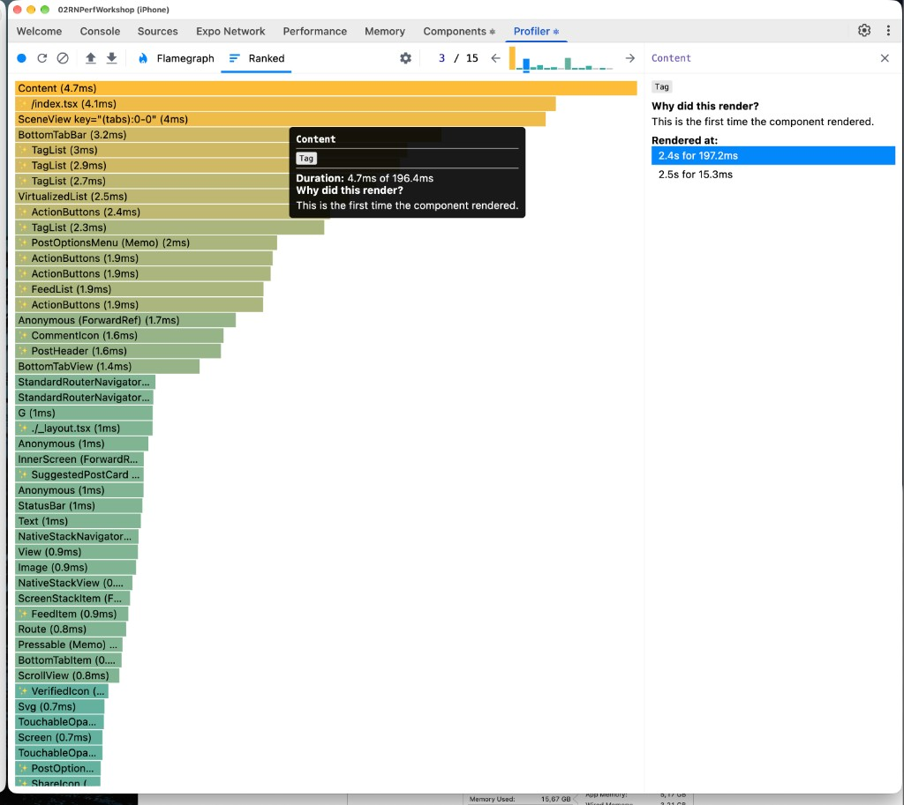
  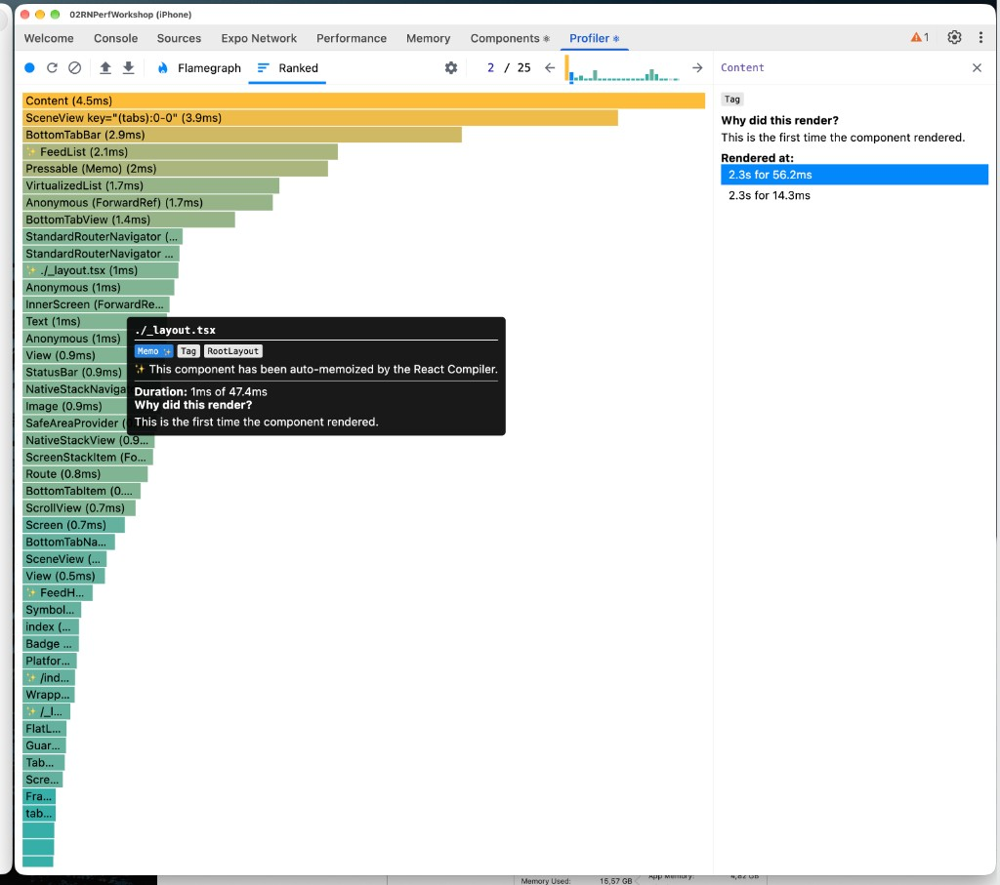

**Stack highlights**

- [React Compiler](https://react.dev/learn/react-compiler) — `experiments.reactCompiler: true` in Expo; fewer manual `memo()` passes on the feed
- React 19 — `Activity`, `startTransition`, and `useDeferredValue` for non-blocking updates
- React Native DevTools — ranked renders and Performance traces as the source of truth for each fix
- [expo-image](https://docs.expo.dev/versions/latest/sdk/image/) — `FeedImage` + display-sized URLs, blurhash placeholders (shimmer removed)
- [FlatList](https://reactnative.dev/docs/flatlist) — narrower `windowSize` / batch sizes for heavy post rows
- `IconSymbol` (SF Symbols / Material) — replaced six hand-rolled SVG icon components

---

## `03_native_modules` — Expo Modules, native views & config plugins

A five-tab workshop app (`apps/03-native-modules`) for building custom native capabilities on iOS and Android using **Expo Modules API** and **Continuous Native Generation (CNG)**. Each tab pairs a reference implementation (existing Expo/community packages) with a custom local module written in Swift and Kotlin, or a custom Config Plugin.

 

  

    
  

  

    <strong><a href="https://youtube.com/shorts/ixXBM7iSLlg">▶ youtube.com/shorts/ixXBM7iSLlg</a></strong>
  

 

  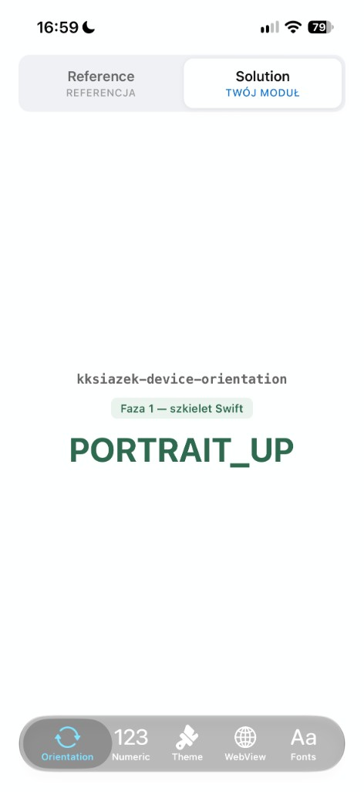
  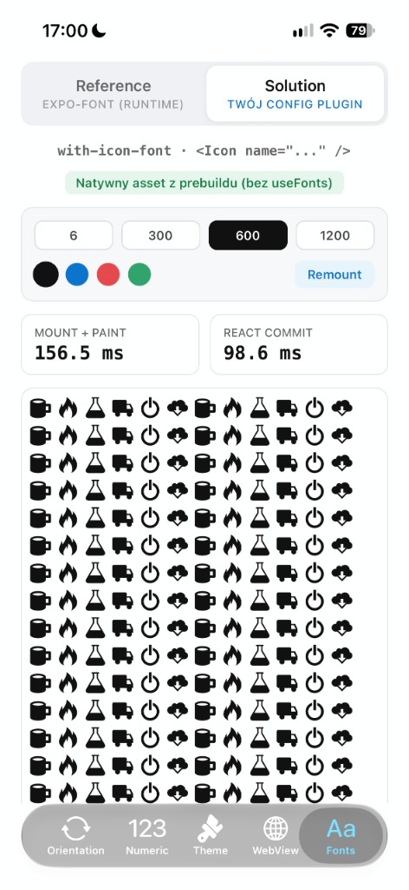

 

| Tab         | Local module / plugin         | What it implements                                                                                                                          |
| ----------- | ----------------------------- | ------------------------------------------------------------------------------------------------------------------------------------------- |
| Orientation | `kksiazek-device-orientation` | `AsyncFunction` (`getOrientationAsync`) + `onOrientationChange` event observer (`UIDevice` / `OrientationEventListener`)                    |
| Numeric     | `kksiazek-numeric-text`       | `ExpoUIView` counter built in **SwiftUI** (iOS) and **Jetpack Compose** (Android)                                                           |
| Theme       | `kksiazek-system-theme`       | Synchronous `Function` (`getColorScheme`) + `onColorSchemeChange` trait/configuration listener                                              |
| WebView     | `kksiazek-webview`            | Native `View` wrapping `WKWebView` / Android `WebView` with `url` prop and `onLoad` event                                                   |
| Fonts       | `plugins/with-icon-font.ts`   | Custom Expo Config Plugin injecting `.ttf` icon fonts into `Info.plist` / Xcode resources & Android assets (600-icon SVG vs font benchmark) |

**Stack highlights**

- [Expo Modules API](https://docs.expo.dev/modules/overview/) — Swift (iOS) and Kotlin (Android) modules with `ModuleDefinition`, `Function`, `AsyncFunction`, `Events`, and `View`
- [@expo/ui](https://docs.expo.dev/versions/latest/sdk/ui/) — `ExpoUIView` bridging SwiftUI and Jetpack Compose views into React Native
- [Expo Config Plugins](https://docs.expo.dev/config-plugins/introduction/) — idempotent `withXcodeProject`, `withInfoPlist`, and `withDangerousMod` mods for CNG
- [SwiftFormat](https://github.com/nicklockwood/SwiftFormat) + [ktlint](https://pinterest.github.io/ktlint/) — native code formatting and linting via `bun run verify:native`

---

## `03_jsi` — C++ JSI & TurboModule bindings

A hands-on **JavaScript Interface (JSI)** lab (`apps/03-jsi`) where a local TurboModule (`kksiazek-jsi`) installs C++ bindings directly into `facebook::jsi::Runtime` on startup, bypassing the asynchronous bridge. All **15 / 15** JSI assignments are implemented and wired to interactive demo screens.

 

  

    
  

  

    <strong><a href="https://youtube.com/shorts/Vm431yy_Kew">▶ youtube.com/shorts/Vm431yy_Kew</a></strong>
  

 

  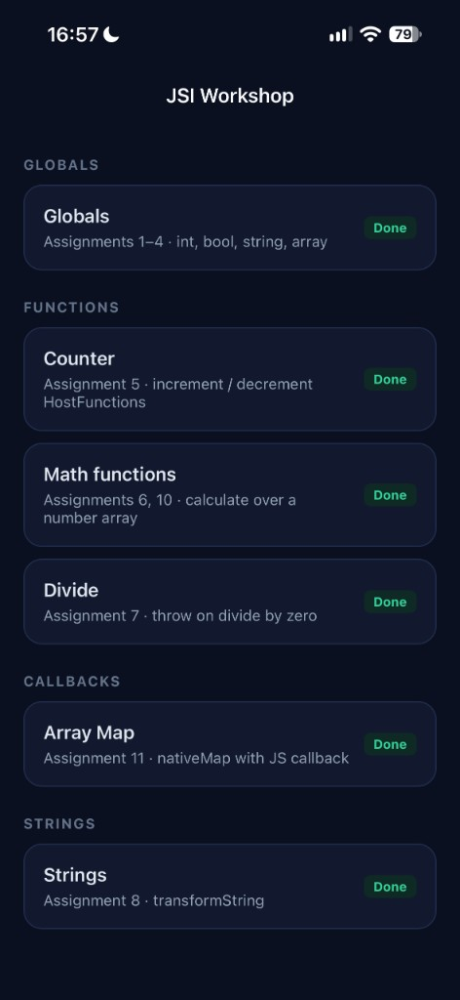
  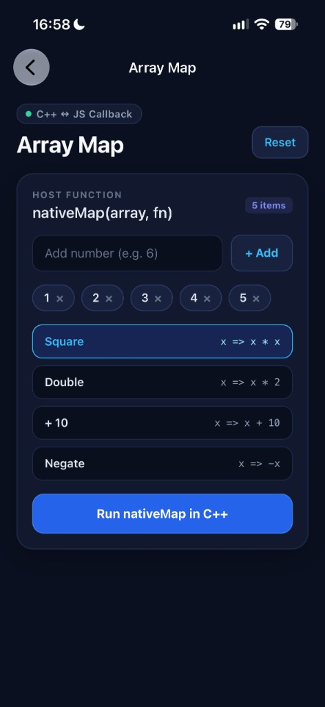

 

| Group                  | Assignments | Key JSI concepts covered                                                                                             |
| ---------------------- | ----------- | -------------------------------------------------------------------------------------------------------------------- |
| Globals                | #1–4        | Primitive `int`, `bool`, `jsi::String`, and `jsi::Array` values on `runtime.global()`                                |
| HostFunctions & errors | #5–7, #10   | `HostFunction` counter, variadic array calculator, throwing `jsi::JSError` on divide-by-zero                         |
| Callbacks & strings    | #8, #11–12  | String transforms, `nativeMap` invoking JS callbacks from C++, calling `global.console.log` from C++                 |
| HostObjects            | #13–14      | `jsi::HostObject` implementations (`getDateObject` with getters/setters, `InfinityObject`)                           |
| Objects & NativeState  | #9, #15     | Reading/returning `jsi::Object` properties (`sumMeThisObject`) and attaching `jsi::NativeState` (`trackNativeState`) |

**Stack highlights**

- [React Native JSI (C++)](https://reactnative.dev/architecture/fabric-renderer) — `jsi::Runtime`, `jsi::HostFunction`, `jsi::HostObject`, `jsi::NativeState`, and `jsi::JSError`
- [Turbo Native Modules](https://reactnative.dev/docs/the-new-architecture/pillars-turbomodules) — `NativeKksiazekJsi` Codegen spec (`TurboModuleRegistry.getEnforcing`) installing C++ globals on iOS & Android
- [Expo Router](https://docs.expo.dev/router/introduction/) — landing index and per-assignment interactive screens under `src/features/`

---

## `04_reanimated` — Reanimated workshop

Ten finished labs in `apps/04-reanimated` (Expo SDK 58, Reanimated 4). A stack landing lists every exercise; each screen drives motion on the UI thread — shared values, gestures, sensors, SVG, Skia, and shared-element transitions.

 

  

    
  

  

    <strong><a href="https://youtube.com/shorts/Nn4dvSo9Yl0">▶ youtube.com/shorts/Nn4dvSo9Yl0</a></strong>
  

 

<table>
  <tr>
    <td>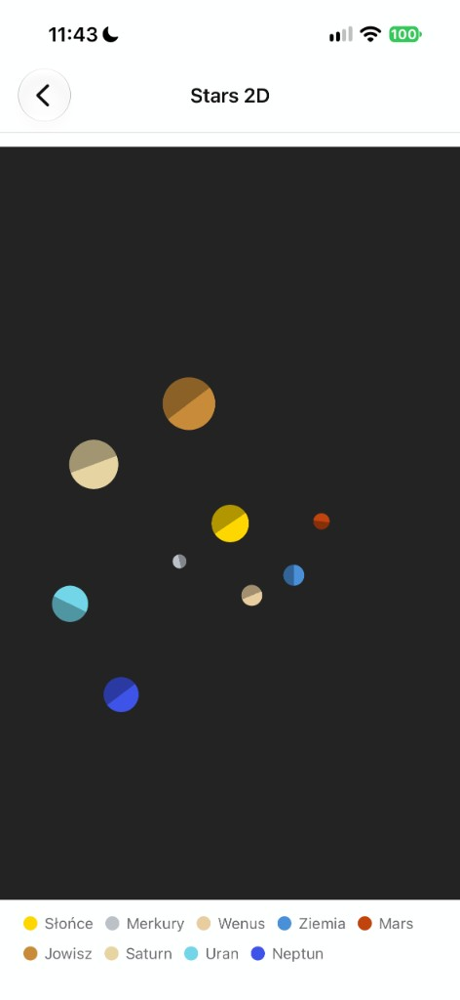</td>
    <td>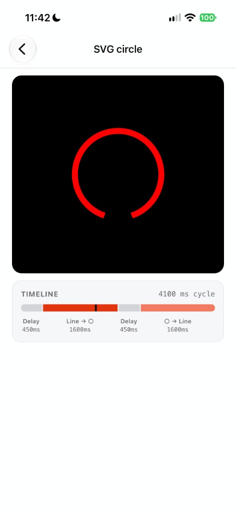</td>
    <td>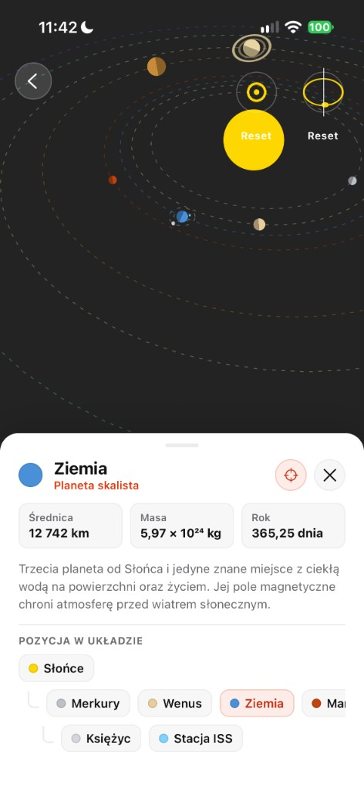</td>
  </tr>
  <tr>
    <td>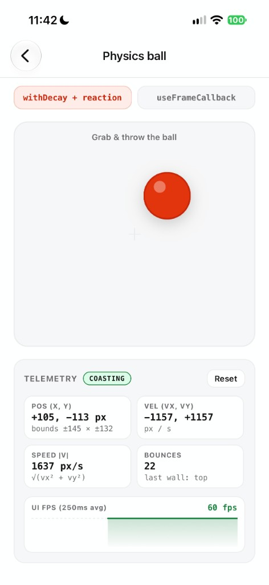</td>
    <td>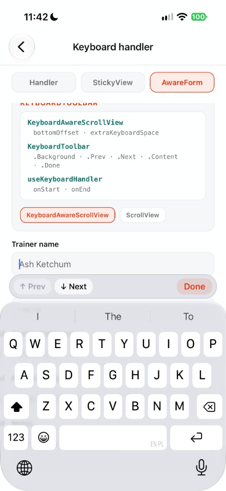</td>
    <td>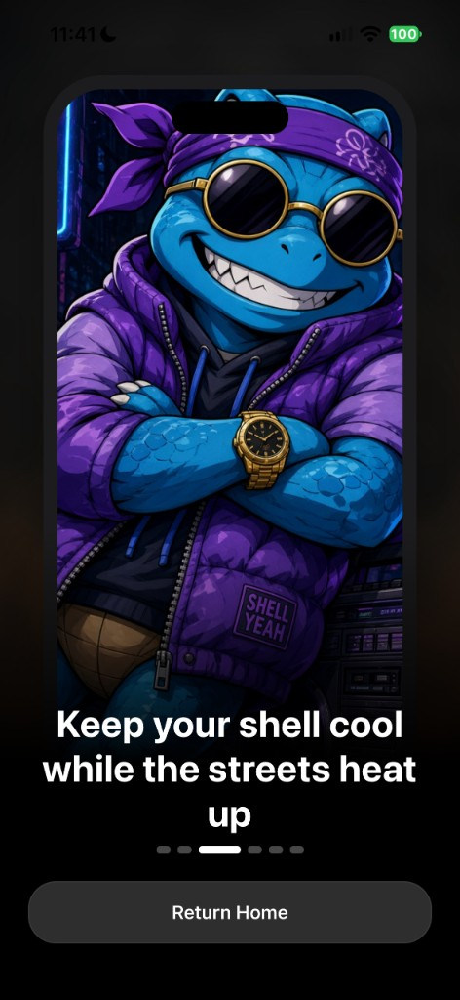</td>
  </tr>
  <tr>
    <td>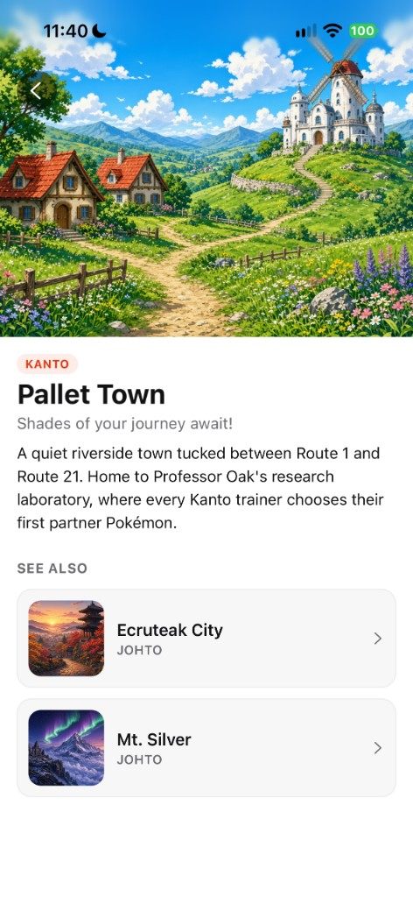</td>
    <td>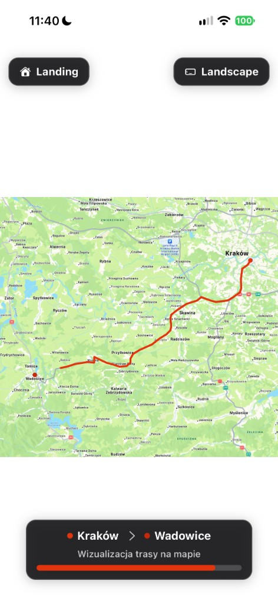</td>
    <td>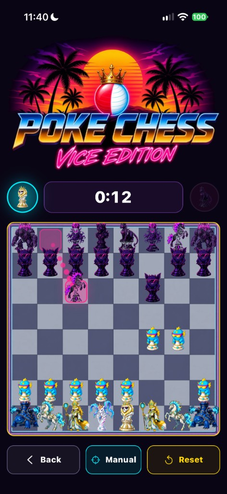</td>
  </tr>
</table>

 

| Exercise | Route | What it practices |
| --- | --- | --- |
| Stars 2D | `/stars-2d` | Planet discs laid out on a 2D field |
| SVG circle | `/svg-circle` | Line ↔ circle stroke on a 4100 ms timeline |
| Stars 3D | `/stars-3d` | Solar system — drag, pinch, planet sheet |
| Physics ball | `/physics-ball` | Throw and bounce: `withDecay` vs `useFrameCallback` |
| Keyboard handler | `/keyboard-handler` | `useKeyboardHandler`, sticky view, `KeyboardAwareScrollView` + toolbar |
| Scroll onboarding | `/scroll-onboarding` | Scroll-linked carousel inside a phone frame |
| Sensors | `/sensors` | Rotation sensor drives a landscape racing game (`useFrameCallback`) |
| Shared transition | `/shared-element-transition` | `sharedTransitionTag` list → detail (hero, title, region) |
| Skia | `/skia` | Skia route over a map, pinch/pan, progress HUD |
| Chess | `/chess` | Animated board, move trail, and engine (`js-chess-engine`) |

**Stack highlights**

- [react-native-reanimated](https://docs.swmansion.com/react-native-reanimated/) 4 — shared values (`.get()` / `.set()`), `withDecay`, `useFrameCallback`, `useAnimatedSensor`, shared element transitions (`ENABLE_SHARED_ELEMENT_TRANSITIONS`)
- [react-native-gesture-handler](https://docs.swmansion.com/react-native-gesture-handler/) — pan, pinch, and throw gestures on the UI thread
- [react-native-worklets](https://docs.swmansion.com/react-native-worklets/) — worklets runtime paired with Reanimated 4
- [react-native-svg](https://github.com/software-mansion/react-native-svg) — animated stroke (line to circle)
- [react-native-keyboard-controller](https://kirillzyusko.github.io/react-native-keyboard-controller/) — keyboard-aware scroll, sticky view, and toolbar
- [@shopify/react-native-skia](https://shopify.github.io/react-native-skia/) — route path drawn on a `Canvas`, driven by a Reanimated progress value
- [js-chess-engine](https://github.com/josefjadrny/js-chess-engine) — move generation behind the animated board
- [Expo Router](https://docs.expo.dev/router/introduction/) — landing list and one stack screen per lab under `src/features/`

<!-- Future apps: copy a showcase block above (heading, short intro, optional YouTube badge, screenshots or profiler captures, stack list). -->
