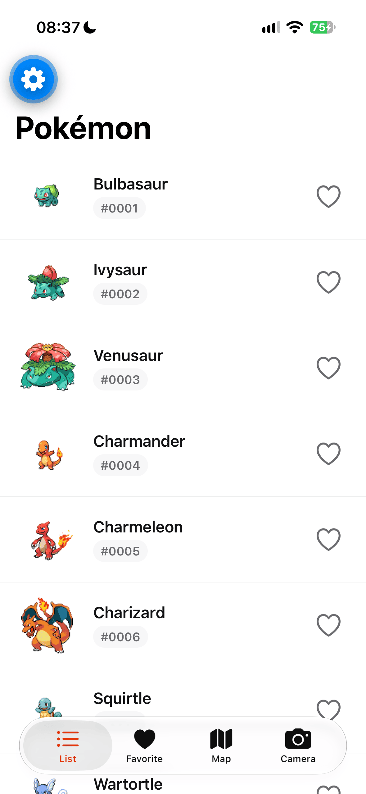
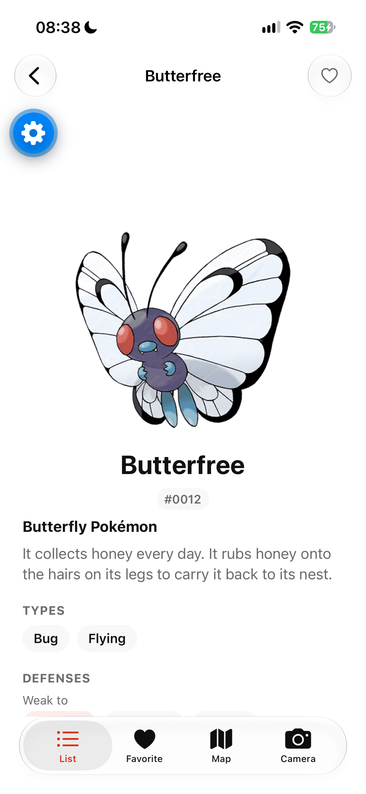
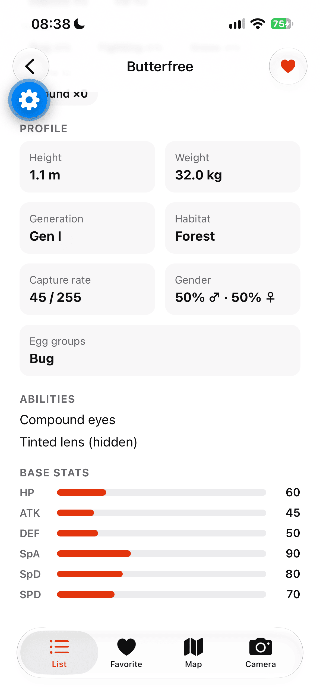
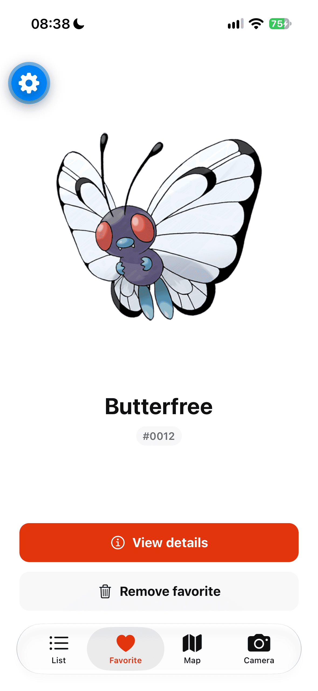
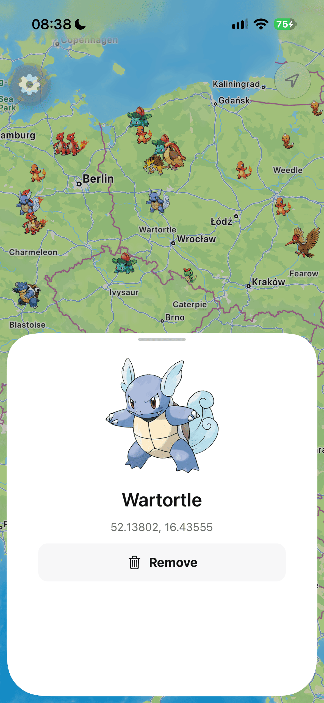
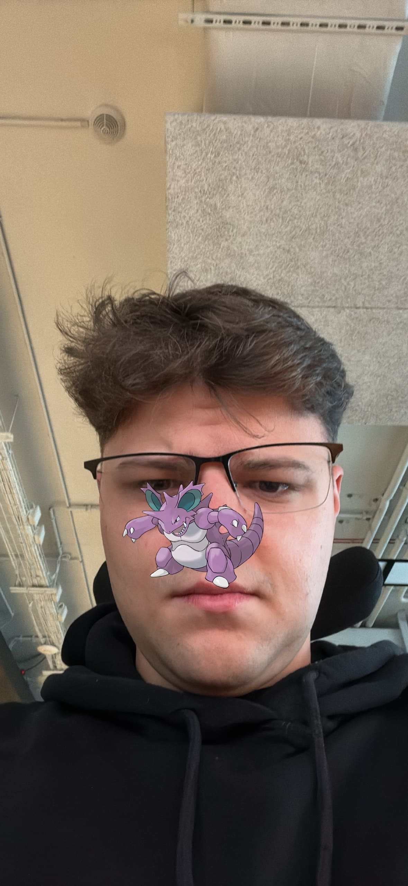

# React Native learning apps

Small Expo apps built step by step to learn React Native. Each project gets a showcase block below: screenshots, a YouTube demo, and the libraries worth studying.

---

## `01_rn_basics` — Pokédex-style client

A hobby training app that talks to [PokeAPI](https://pokeapi.co) and grows through four native tabs. The list paginates and drills into detail; favorite and map pins persist in SQLite on device. The camera tab uses face detection to stick your favorite Pokémon on screen and save a composed photo.

<h2 align="center">
  <a href="https://www.youtube.com/shorts/C_FTkzZ7Y3o">
    
  </a>
</h2>

<p align="center">
  <strong><a href="https://www.youtube.com/shorts/C_FTkzZ7Y3o">▶ youtube.com/shorts/C_FTkzZ7Y3o</a></strong>
</p>

<p align="center">
  
  
  
</p>
<p align="center">
  
  
  
</p>

**Stack highlights**

- [Expo Router](https://docs.expo.dev/router/introduction/) — file routes, [native tabs](https://docs.expo.dev/router/advanced/native-tabs/), nested stacks for list → detail
- [expo-sqlite](https://docs.expo.dev/versions/latest/sdk/sqlite/) + [Drizzle ORM](https://orm.drizzle.team/) — favorites and map pins with migrations
- [expo-maps](https://docs.expo.dev/versions/latest/sdk/maps/) — fullscreen map, annotations, bottom sheets for pin UX
- [react-native-vision-camera](https://react-native-vision-camera.com/) — camera preview, face-guided sticker placement (iOS)
- [react-native-view-shot](https://github.com/gre/react-native-view-shot) + [expo-media-library](https://docs.expo.dev/versions/latest/sdk/media-library/) — capture composed shots to the gallery
- [react-native-reanimated](https://docs.swmansion.com/react-native-reanimated/) — animations and worklets (React Compiler–friendly patterns)
- [expo-image](https://docs.expo.dev/versions/latest/sdk/image/) + [react-native-nitro-image](https://github.com/mrousavy/nitro/tree/main/packages/react-native-nitro-image) — fast Pokémon artwork loading
- [Biome](https://biomejs.dev/) + [Bun](https://bun.sh/) — lint, format, and installs in this repo

<!-- Future apps: copy the block above (heading, 3 sentences, YouTube badge, screenshot row, stack list). -->

---

## Development

Apps live under **`apps/`**. The first project is [`apps/01-rn-basics/`](apps/01-rn-basics/).

```bash
bun install
bun run start          # Expo dev server (01-rn-basics)
bun run ios            # development build when native modules are needed
bun run lint && bun run typecheck
```

You can also `cd apps/01-rn-basics` and run `bun run start` from there.

- **CI:** lint, TypeScript, and `expo export` for iOS + Android — [docs/ci-required-checks.md](docs/ci-required-checks.md)
- **AI / process rules:** [docs/ai-coding-rules/](docs/ai-coding-rules/) and [project brief](docs/ai-coding-rules/concept/project-brief.md)
- **README screenshots:** add PNGs under [docs/readme-assets/01-rn-basics/screenshots/](docs/readme-assets/01-rn-basics/screenshots/) (see [docs/readme-assets/README.md](docs/readme-assets/README.md))
