# 02-rn-perf: JS Performance Summary

Feed-style workshop app (`apps/02-rn-perf`, Expo SDK 58, React 19, Hermes) profiled with React Native DevTools (Profiler + Performance tabs). Every fix below was measured before and after on the same workflow.

## Results at a glance

| # | Fix | Metric | Before | After | Gain |
|---|-----|--------|--------|-------|------|
| 1 | Local engagement state (`PostDetailEngagement`) | Component re-rendered on like tap | `./post/[id].tsx`: 73.6 ms (commit 123.7 ms) | `PostDetailEngagement`: 2.2 ms | **~33× less** on the component, whole-screen re-render gone |
| 2 | Isolated `CommentInput`, `ColorsProvider` in root | `VirtualizedList` commit (reply workflow) | 262.6 ms, ~10 `CommentItem` re-renders at 0.6–0.7 ms | 17.2 ms, 5 `CommentItem` at 0.4–0.5 ms | **~15× faster** commit |
| 2.3 | React Compiler | Heaviest feed commit (like) | ~204 ms, 51 commits | ~51.6 ms, 143 commits (mostly low bars) | **~4× faster** |
| 3 | `Activity` + `startTransition` | First paint of post detail | Related posts inside the blocking render | Related posts moved to a transition render (~741 ms selection, off the first paint) | First paint unblocked |
| 3.2 | Deferred feed hydration + compiler | First `Content` commit on Home | ~197 ms | ~56 ms | **~3.5×** (−140 ms) |
| 4 | `expo-image`, `IconSymbol`, tight `FlatList` window | Code / render work | 9 files removed (6 SVG icons, 3 shimmers) | 8 `FeedImage` call sites, window 21 → 5 | **−528 / +91** lines in 21 files |

Frame budget for reference: 16 ms at 60 fps, 8 ms at 120 fps.

---

## Exercise 1: Local engagement state

**Problem.** `like` lived in `PostDetailScreen` state, so one tap re-rendered the whole `./post/[id].tsx` tree.

**Fix**

- Extracted like / bookmark / share into `PostDetailEngagement` with its own state.
- `StyleSheet` instead of inline styles in header and engagement.
- Stable `PostOptionsMenu` API (`setVisible` instead of inline `onClose`).

**Workflow:** tap like in post detail.

| Before | After |
|---|---|
| 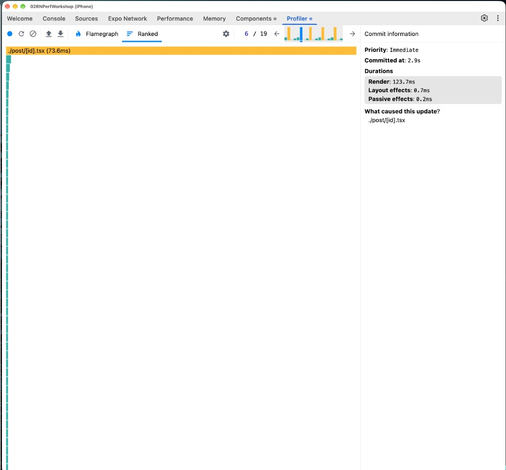 | 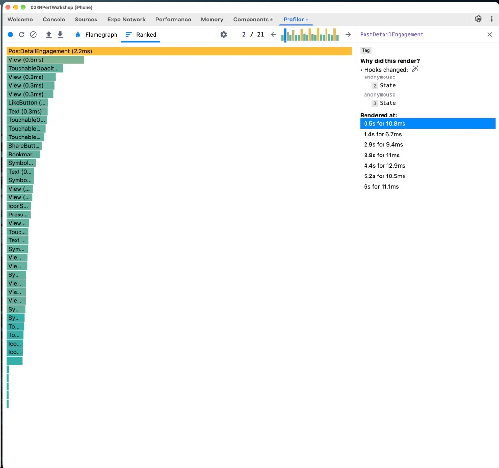 |
| Whole `./post/[id].tsx` re-renders: **73.6 ms** (commit render **123.7 ms**) | Only `PostDetailEngagement` re-renders: **2.2 ms** (state hooks changed); repeated taps cost 6.7–12.9 ms per commit |

---

## Exercise 2: Break up `PostDetailScreen`

**Problem.** The screen owned everything: comment draft (`newComment`), `colors` passed as props to every row, `findRelatedPosts` computed inline in the footer, and a local `ColorsContext.Provider`. Each keystroke, reply toggle or thread expand re-rendered the parent and, with it, every `CommentItem` and the `VirtualizedList`.

**Fix**

| Area | Change |
|---|---|
| `post/[id].tsx` | Removed `newComment`; `handleAddComment(draft)` takes text from the input; footer → memoized `PostDetailRelatedPosts`; `CommentItem` no longer takes `colors`. |
| `CommentInput` | Monolith → folder (`useCommentInput`, own text state, `replyTo` in the hook). Typing no longer re-renders the screen. |
| Theme | `ColorsProvider` in root `_layout.tsx`; per-screen providers removed; components read `ColorsContext`. |
| Related | Same input pattern in `post/comments/[id].tsx`; slimmer props on `LikeButton` / `ShareButton` / `BookmarkButton`. |

**Workflow:** expand replies under the first comment → reply → submit.

| Before | After |
|---|---|
| 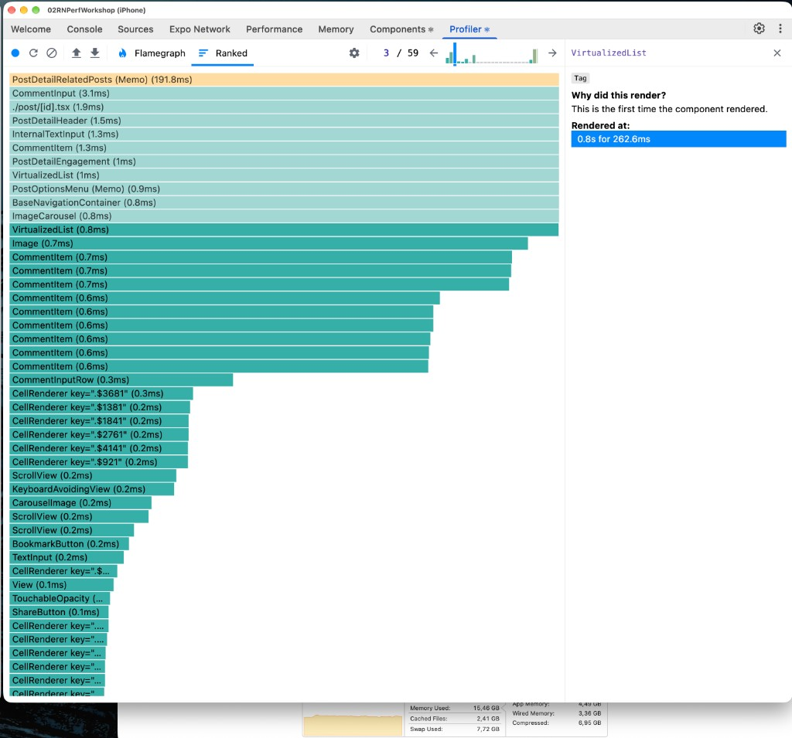 | 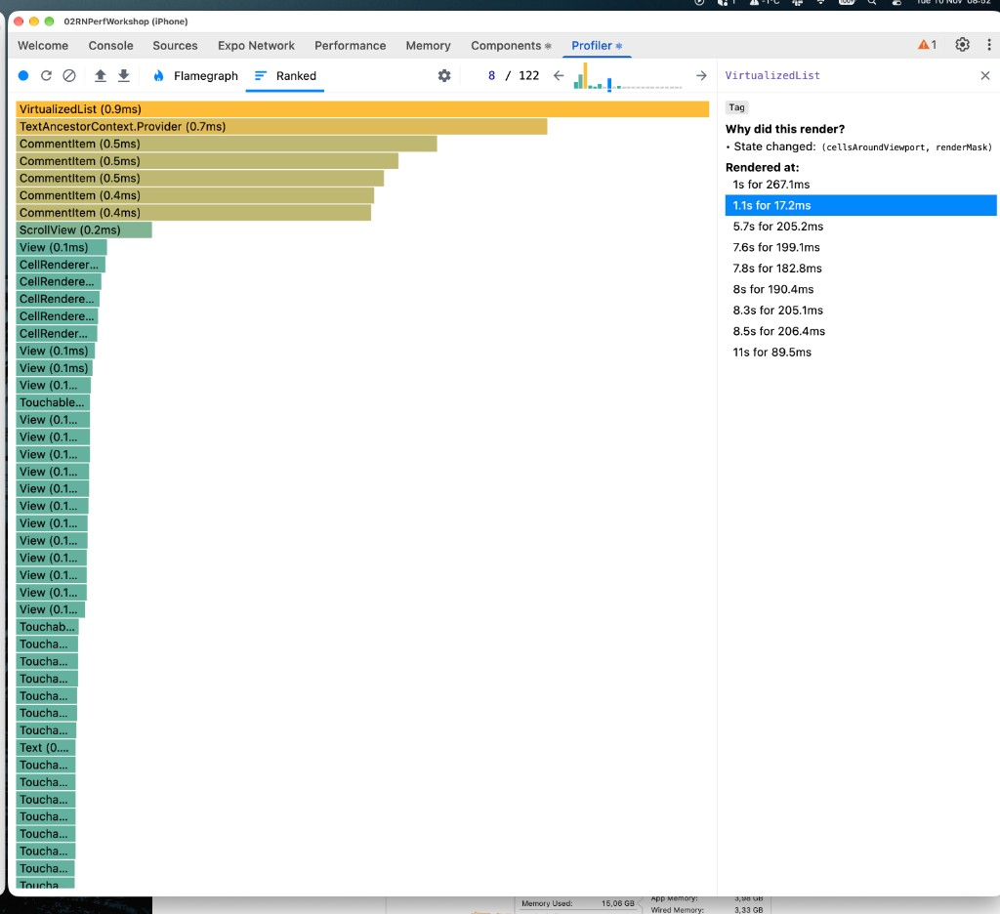 |
| `VirtualizedList` commit **262.6 ms**; `PostDetailRelatedPosts` **191.8 ms**; `CommentInput` 3.1 ms; ~10 `CommentItem` at 0.6–0.7 ms | `VirtualizedList` commit **17.2 ms**; 5 `CommentItem` at 0.4–0.5 ms; update caused only by internal state (`cellsAroundViewport`, `renderMask`) |

**Result.** Mass re-render of the comment list is gone; the list now updates through its own virtualization state only.

---

## Exercise 2.3: React Compiler (feed)

**Problem.** Liking a post updates `feedData` in `HomeScreen`. The profiler shows one commit of **~204 ms** (2 / 51) full of repeated `TagList`, `ActionButtons`, `PostHeader` and icons. "Why did this render?" says only **The parent component rendered**: props did not change, children re-rendered anyway.

**Fix.** `experiments.reactCompiler: true` in `apps/02-rn-perf/app.json`. No manual `memo()` across the feed.

**Workflow:** scroll feed → like one or several posts.

| Before: ranked | After: ranked |
|---|---|
| 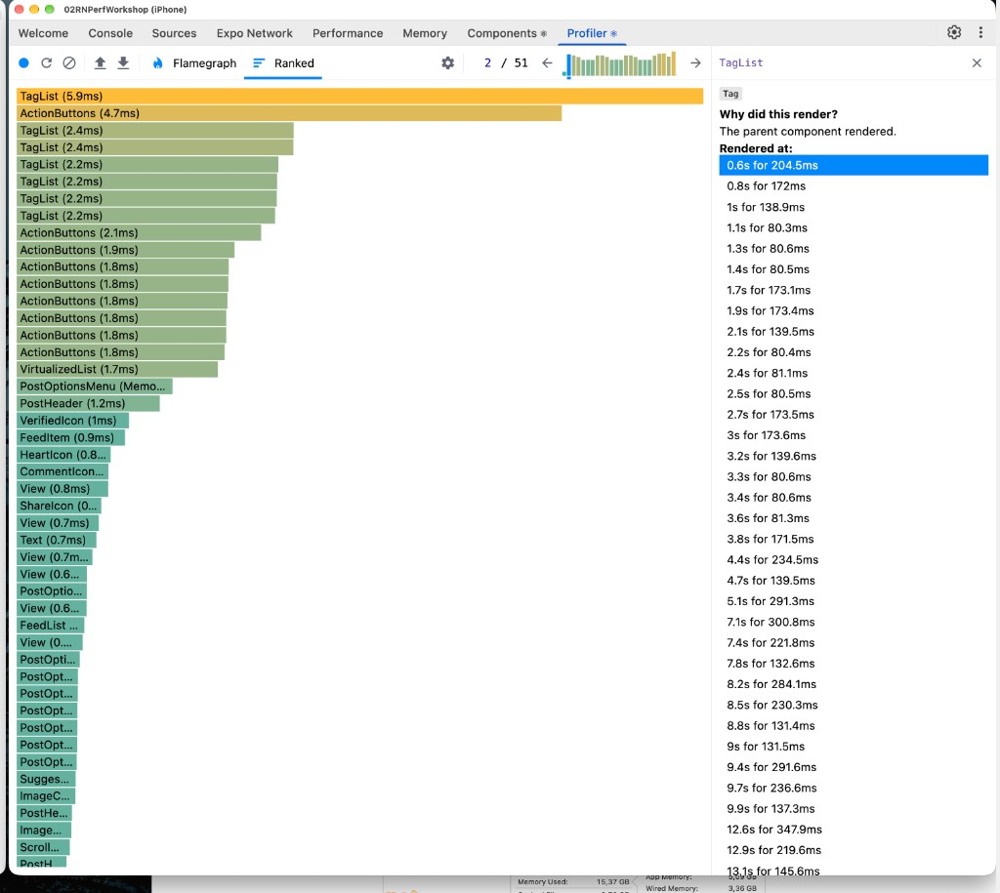 | 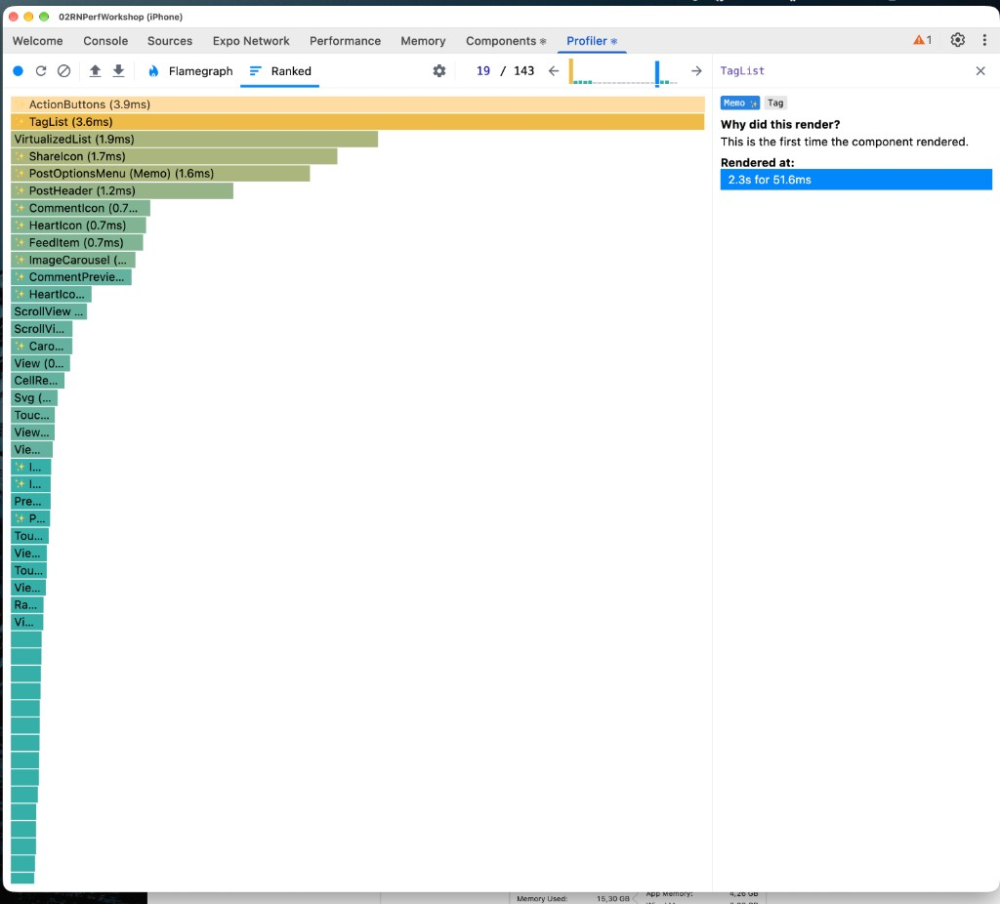 |
| ~**204 ms**, wall of `TagList` / `ActionButtons` / `PostHeader` | ~**51.6 ms**, `Memo ✨` on `TagList`, `FeedItem`, `PostHeader`, icons |

| Before: commit timeline | After: commit timeline |
|---|---|
| 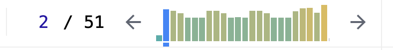 | 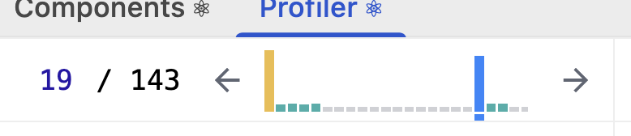 |
| 51 commits, dense yellow bars | 143 commits, mostly low green bars |

**Result.** Rows whose props did not change are skipped. About **4× faster** heaviest commit.

---

## Exercise 3: `Activity` + `useTransition` (related posts)

**Problem.** The `PostDetailRelatedPosts` footer (`findRelatedPosts`) mounted in the first paint. The Performance tab shows a long blocking **Render** on `PostDetailScreen` with a red `PostDetailRelatedPosts` bar in the same window as the list mount.

**Workflow:** open `post/[id]` and record in the Performance tab.

| Variant | What it does | Trace |
|---|---|---|
| Default | Footer in `ListFooterComponent` immediately | 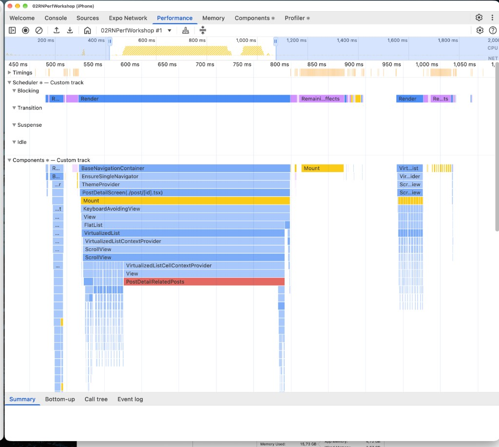 |
| Lazy + `Suspense` | `React.lazy` footer | 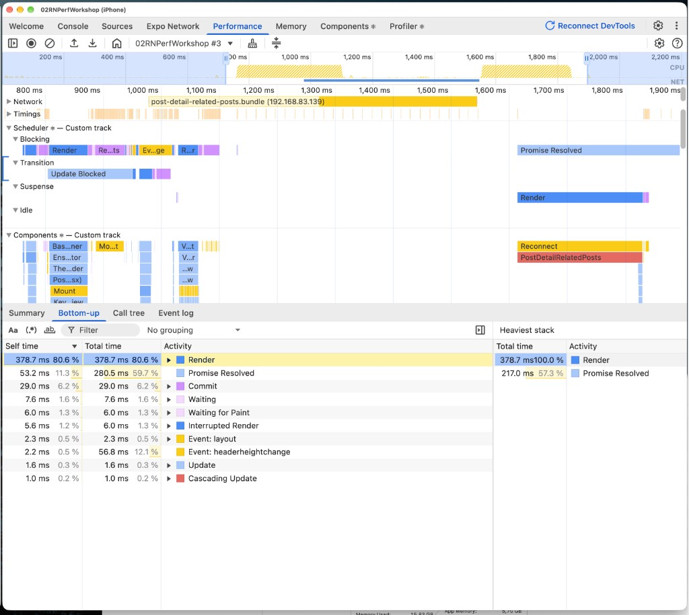 |
| **`Activity` + `startTransition`** (chosen) | Mount deferred: first paint without footer → `hidden` → `visible`, both in a transition | 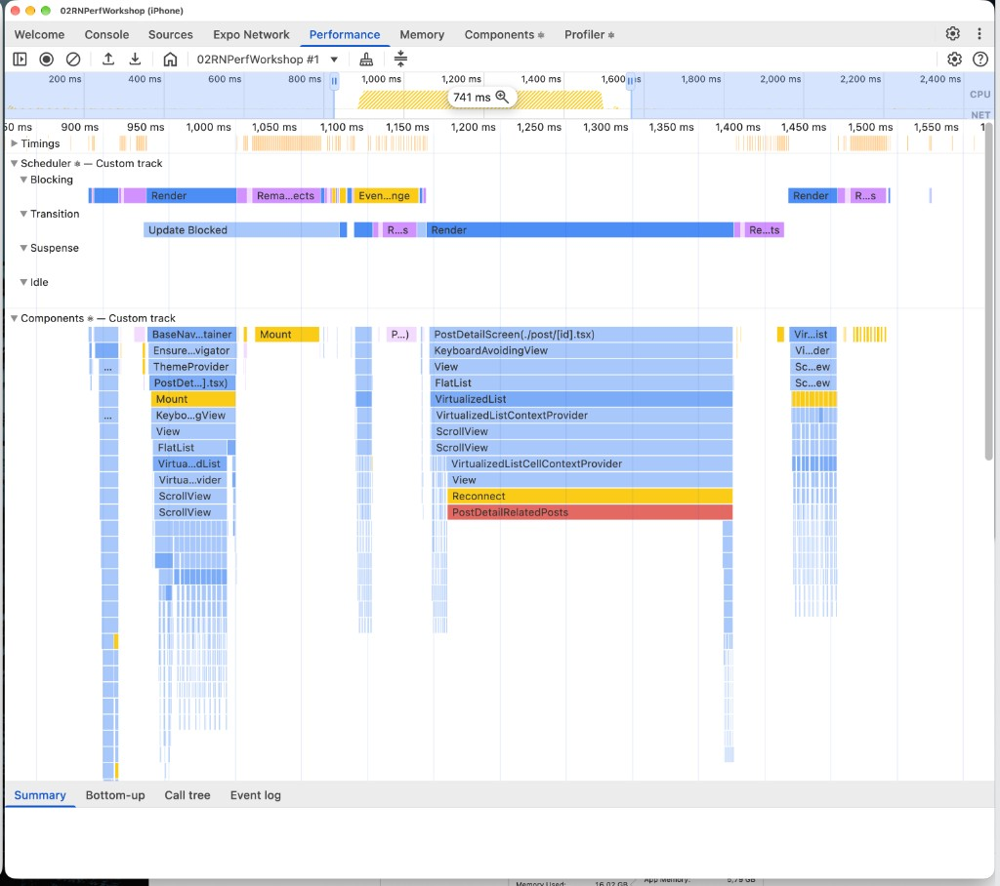 |

- **Default:** `PostDetailRelatedPosts` sits inside the same **blocking** render as the `FlatList`.
- **Lazy:** self time **Render ~379 ms** plus **Promise Resolved ~217 ms** for chunk loading: it only moves the cost, and adds a load.
- **Activity + transition:** the first paint is short; `PostDetailRelatedPosts` + `Reconnect` land in a later **Transition** render (~741 ms selection), after `Update Blocked`.

**Implementation**: `src/hooks/use-deferred-mount-activity-props.ts`:

```ts
export function useDeferredMountActivityProps(): ActivityProps | null {
  const [mode, setMode] = useState<ActivityMode | null>(null);

  useEffect(() => {
    startTransition(() => setMode("hidden"));
  }, []);

  useEffect(() => {
    if (mode !== "hidden") return;
    startTransition(() => setMode("visible"));
  }, [mode]);

  return mode === null ? null : { mode };
}
```

```tsx
<Activity {...relatedActivityProps}>
  <PostDetailRelatedPosts post={post} />
</Activity>
```

`hidden` pre-renders the tree off-screen (state kept, nothing shown); `visible` reveals it. Both steps are transitions, so they never block the first interactive paint.

---

## Exercise 3.2: Transitions and deferred values (Home feed)

**Problem.** The first render of Home mounted the whole visible feed synchronously (`toSlimFeed(MOCK_FEED)` in a `useState` initializer), so one commit pulled dozens of `TagList` / `ActionButtons` / `PostHeader`.

**Fix**

- `(tabs)/index.tsx`: list starts empty; mock hydration runs in `useEffect` + `startTransition`.
- `ActionButtons`: `useDeferredValue(likes)` feeds `computeEngagementRate`, so the expensive calculation can lag behind the tap.
- React Compiler memoizes unchanged rows (`6a1e561`).

| Before | After |
|---|---|
| 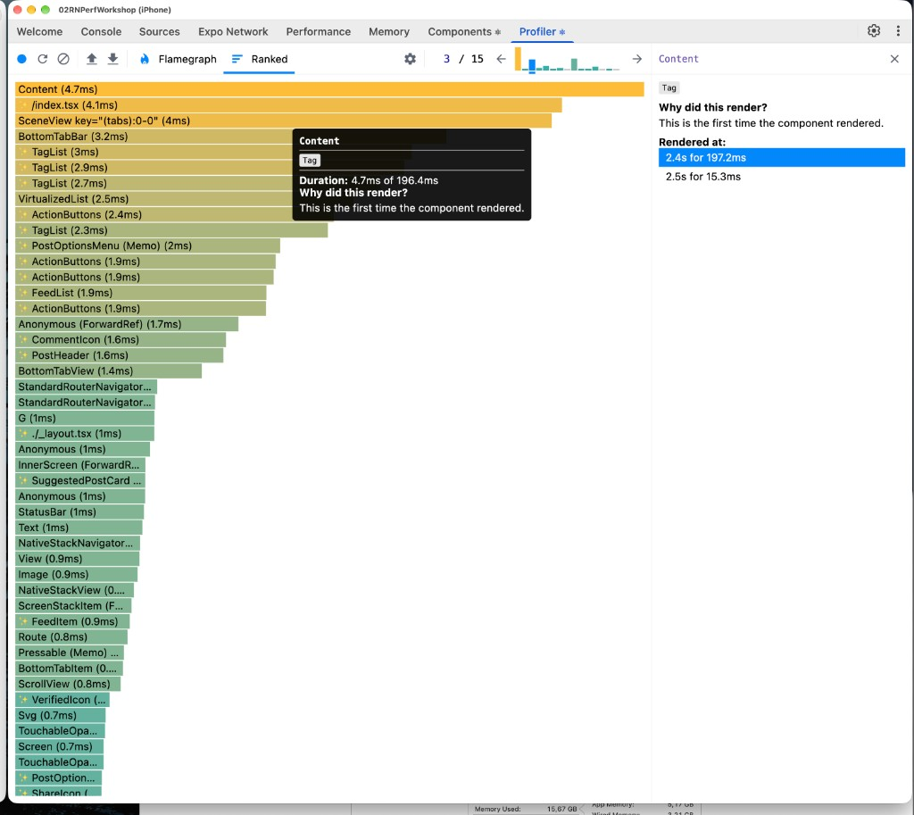 | 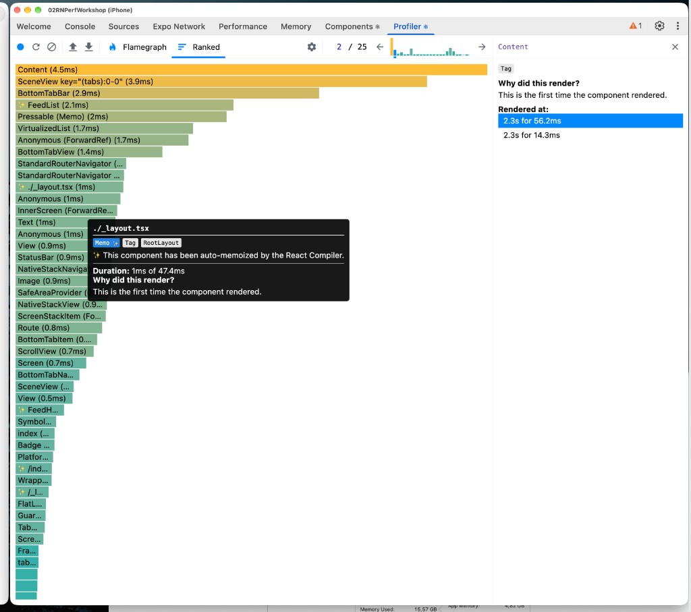 |

| Metric | Before | After |
|---|---|---|
| First heavy commit | ~197 ms (at 2.4 s) | ~56 ms (at 2.3 s) |
| `Content` self time | 4.7 ms | 4.5 ms |
| Next commit nearby | ~15 ms | ~14 ms |

**~3.5× shorter first commit (≈ −140 ms).** `Content` self time is unchanged by design: it is just the navigation slot; the win is in the list subtree.

---

## Exercise 4: List performance: draw less (+ tighter FlatList window)

21 files changed, **−528 / +91** lines, plus new `feed-image.tsx`. 9 files deleted (6 SVG icons, 3 shimmer components). Covers Lever 1 of the list-performance brief in full and part of Lever 3. No profiler screenshots: these changes reduce work per row rather than a single commit.

### 1.1 `expo-image` instead of RN `Image`

One wrapper, `FeedImage`, plus `displaySource(uri, w, h)` which requests `Math.round(points × PixelRatio.get())` pixels, so a 20–36 px avatar does not decode a full bitmap. **8** call sites:

| Place | Size (pt) |
|---|---|
| `carousel-image` | 400 × 400 / aspect |
| `post-detail-related-posts` | 140 × 140 |
| `suggested-post-card` image | 160 × 160 |
| `post-detail-header` avatar | 36 × 36 |
| `comment-item` avatar | 36 (28 for replies) |
| `post-header` avatar | 32 × 32 |
| `comment-preview` avatar | 28 × 28 |
| `suggested-post-card` avatar | 20 × 20 |

### 1.2 Shimmer removed, blurhash in

Deleted `shimmer-view.tsx` (an `Animated` loop **without** the native driver), `image-shimmer.tsx`, `image-with-shimmer.tsx`. `FeedImage` always uses a blurhash placeholder, `contentFit="cover"` and a 200 ms crossfade. 5 former `ImageWithShimmer` and 3 raw RN `Image` usages now share one component.

### 1.3 SVG → `IconSymbol`

Removed the `icons/` folder (6 components: heart, comment, share, bookmark, verified, menu: `menu-icon` alone was 154 lines of paths). Added **10** `MAPPING` entries to `icon-symbol.tsx`. Replaced:

- action bar: `heart` / `heart.fill`, `bubble.right`, `paperplane`
- post header / detail: `checkmark.seal.fill`, `mappin`, `ellipsis`
- options menu: 6 icons via `MENU_SYMBOLS`

### 3.1 FlatList window

Rows are heavy (~1 post per viewport), so the window was narrowed deliberately:

| Prop | Before | After |
|---|---|---|
| `windowSize` | 21 | **5** |
| `maxToRenderPerBatch` | 10 | **2** |
| `initialNumToRender` | 5 | **2** |
